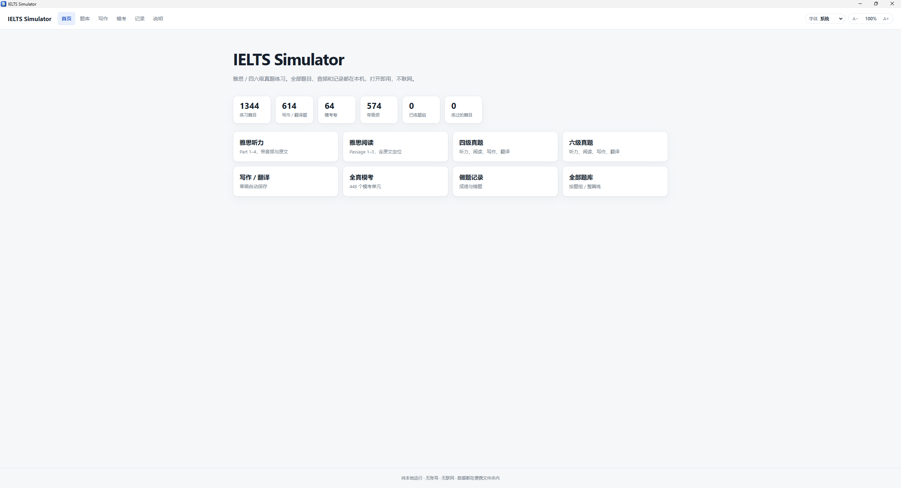
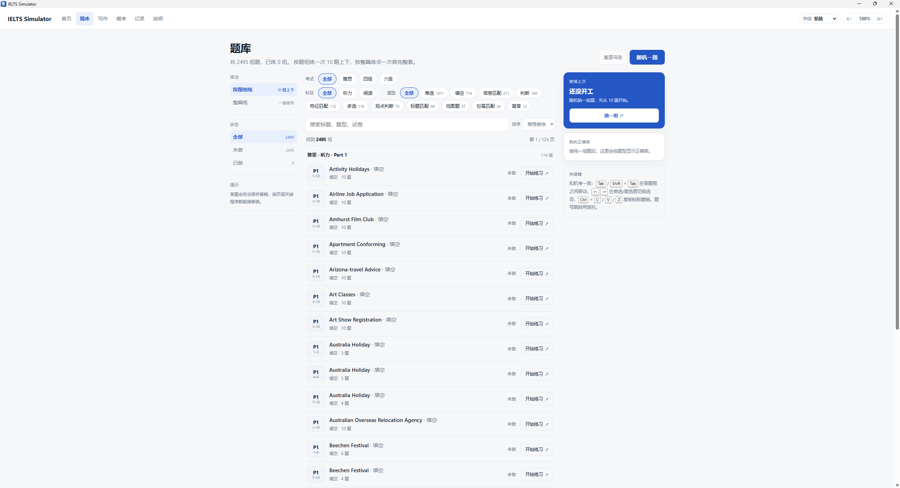
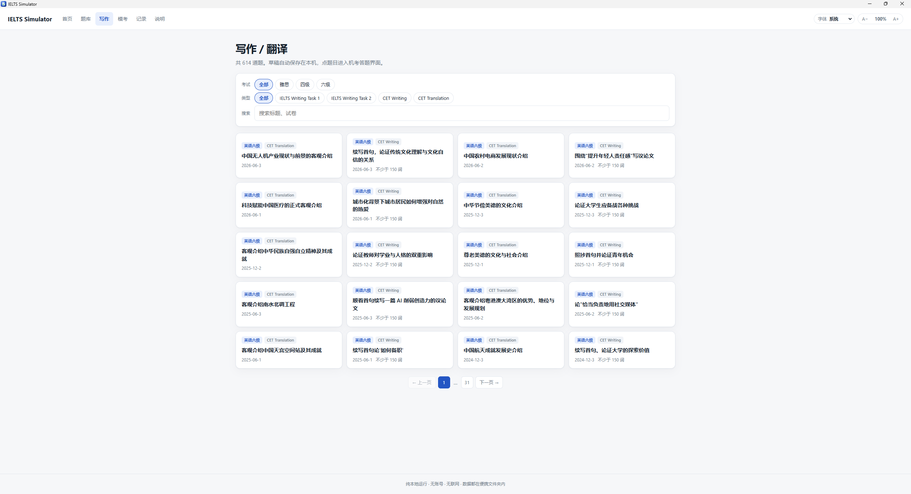
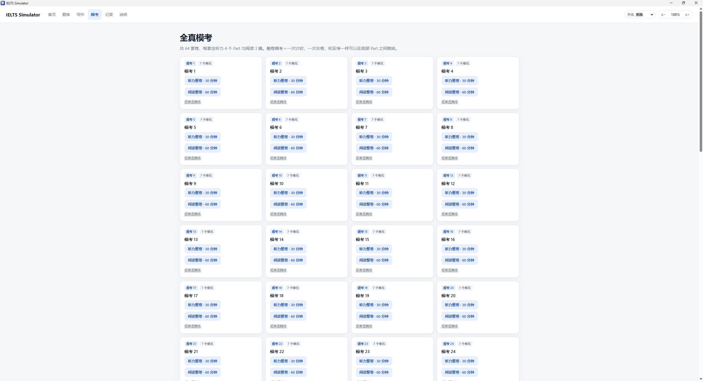
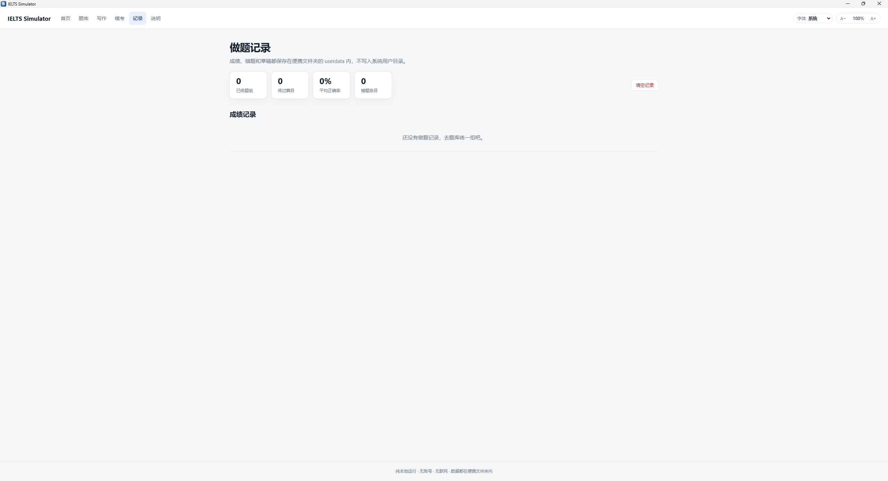
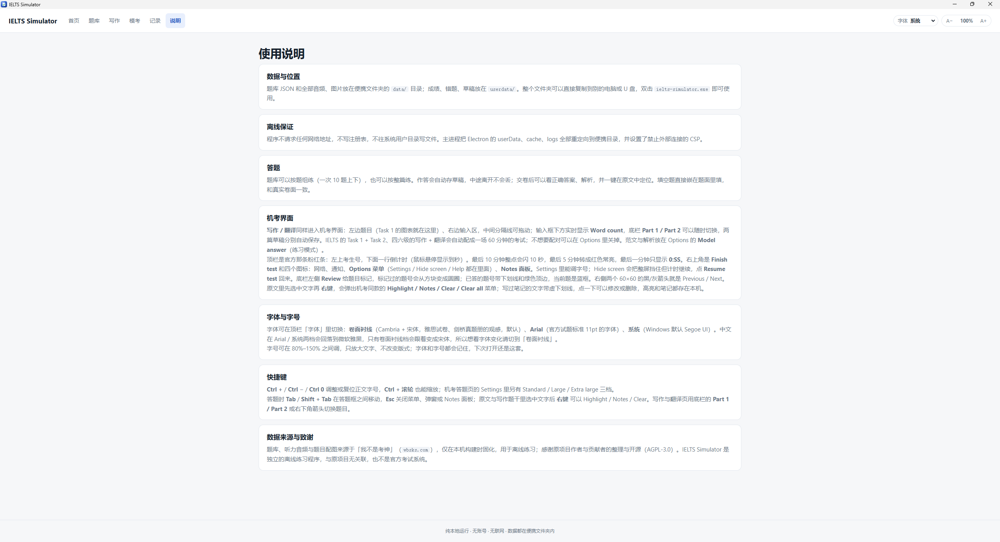
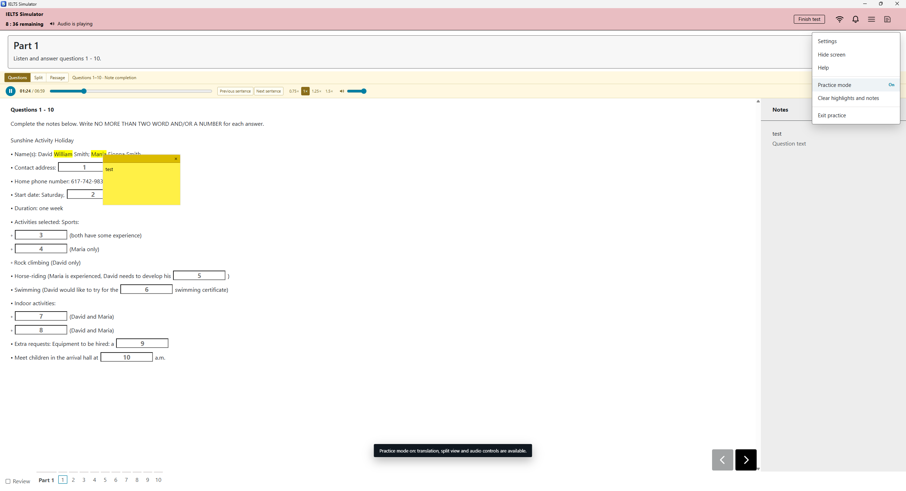
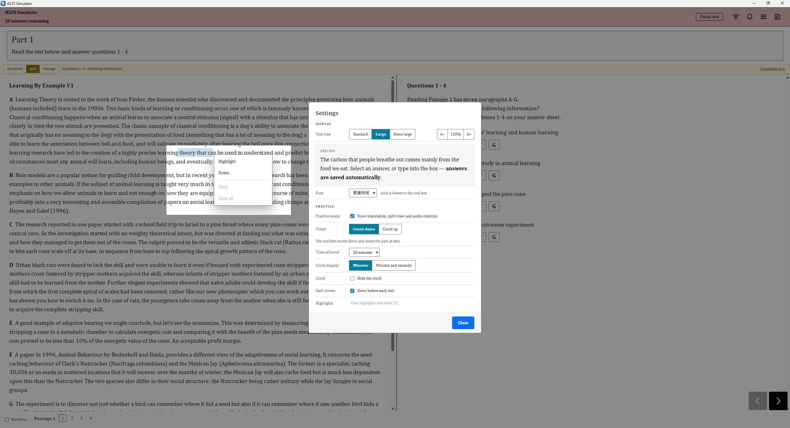
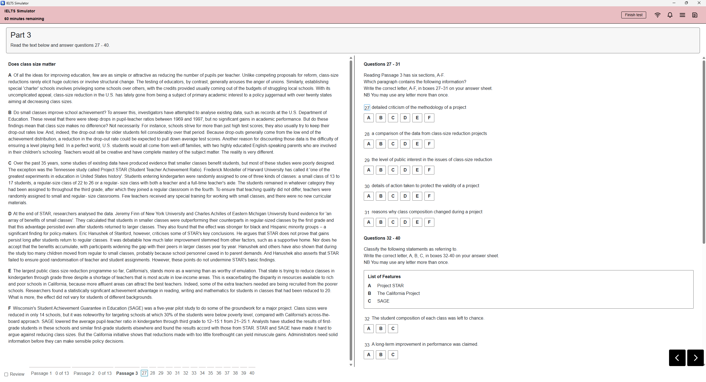

<div align="center">


# IELTS Simulator

**把雅思机考搬进一个文件夹：完全离线的绿色便携版。**

1,792 篇练习单元 · 18,169 道题 · 64 套整卷模考 · 574 段听力音频 · 零联网 · 解压即用

[](https://github.com/H1DDENADM1N/IELTS-Simulator/releases)
[](LICENSE)


</div>

# IELTS Simulator

雅思 / 四六级真题离线练习程序，没有任何联网功能。

考试界面与交互逆向自 [雅思官方模考](https://cdielts.gelielts.cn/) 。

绿色便携，全部保存在程序自己的文件夹里，不写系统用户目录和注册表。

## 预览图

| 首页 | 题库 | 写作 |
|---|---|---|
|  |  |  |

| 模考 | 记录 | 说明 |
|---|---|---|
|  |  |  |

| 模考-听力-练习模式 | 模考-阅读-练习模式 | 模考-整卷 |
|---|---|---|
|  |  |  |

> [!TIP]
> 按 `F11` 键进入全屏可获得更佳沉浸真实考场体验

## 直接用

从 [releases](https://github.com/H1DDENADM1N/IELTS-Simulator/releases) 下载并解压后，双击 `ielts-simulator.exe` 直接用。整个文件夹可以复制到 U 盘或另一台 Windows 电脑。

- `data/` — 题库 JSON、听力音频、题目配图
- `userdata/` — 成绩、错题、答题草稿、写作草稿（自动生成；删掉即清空记录）
- `resources/` — 程序本体

## 从源码构建

```bash
pnpm install
pnpm split     # 题库拆分：units.json → data/units-index.json + data/units/<id>.json
pnpm build      # Vite → dist/index.html（单文件，含离线 CSP）
pnpm bundle    # 组装便携文件夹（首次需联网下载 Electron 运行时）
pnpm pack7z    # 把便携文件夹打成 7z（默认排除本地记录）
pnpm selftest  # 三层自检：数据 / 构建 / 纯逻辑 / 真实窗口全流程
```

`pnpm split` 只在题库更新后需要重跑。拆分是启动内存的关键：整包 30 MB 的 `units.json` 解析后要占约 42 MB 堆，拆成「索引 + 单篇」后启动只读 0.7 MB，打开一篇再加约 50 KB（最近 8 篇走缓存）。仓库只保留 `data/units.json` 和 `data/mock-papers.json` 这两个拆分源，`pnpm bundle` 不会把它们放进成品；听力音频、题目配图与拆分产物不纳入版本库，需自备后放入 `data/`。

`pnpm pack7z` 常用参数：`--split=3500m`（FAT32 U 盘分卷）、`--include-userdata`（连答题记录一起打包）、`--test`（校验完整性）、`--level=0`（纯存储最快）、`--out=...`（自定义输出）。完整说明见 `pnpm pack7z --help`。

图标母版是 `build/icon.svg`，产物 `build/icon.ico` / `build/icon-1024.png` 已入库；改图标后跑一次 `node tools/icon.mjs --force` 重新渲染（需要本机 Chrome）。`pnpm bundle` 会把图标写进 exe 的 Win32 资源，资源管理器、任务栏和 Alt+Tab 显示的都是本项目图标，不再是 Electron 默认图标。

开发调试用 `pnpm dev:app`（Vite 热更新 + Electron 窗口）。

构建期需要联网下载 Electron 运行时；成品运行时完全离线：主进程硬阻断所有非本地文件请求，页面 CSP 为 `connect-src 'none'`，Electron 的 userData / cache / logs 全部重定向到便携目录。

## 数据来源与致谢

题库、听力音频与题目配图来源于[我不是考神](https://wbsks.com)（ [onewhitethreee/wobushikaoshen](https://github.com/onewhitethreee/wobushikaoshen) ），在本项目构建期一次性整理并固化到 `data/`，程序运行时不访问该站点。感谢原项目作者与贡献者对这些资料的整理与开源。

IELTS Simulator 是独立的离线练习程序，与原项目无关联，也不是任何官方考试系统；题目、音频与商标归各自权利人所有。许可证沿用 AGPL-3.0，见 [LICENSE](LICENSE)。
